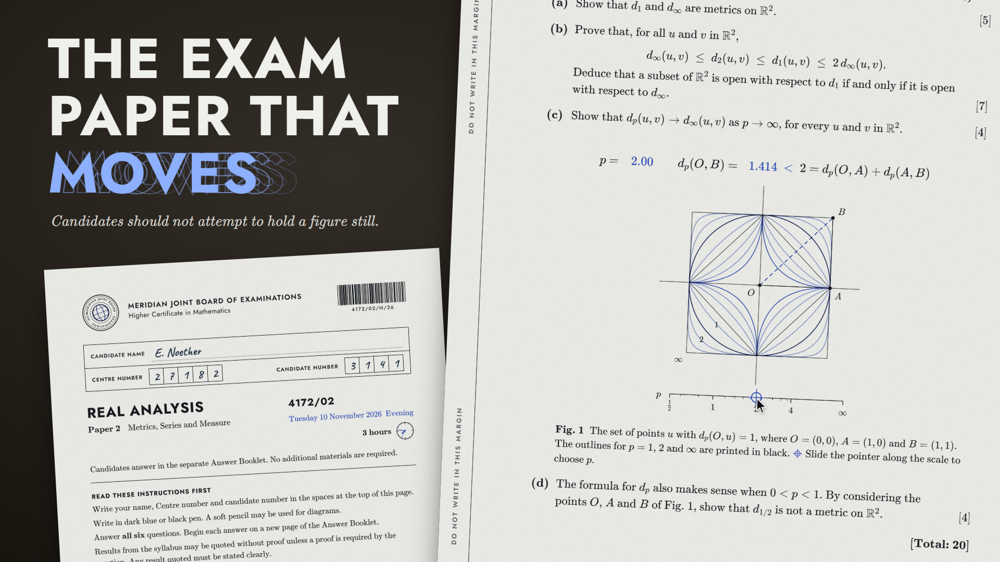

# The exam paper that moves

[](https://ruiqichenbiec.github.io/living-exam/)

**[Open the paper](https://ruiqichenbiec.github.io/living-exam/)** · **[Watch the 30-second film](https://ruiqichenbiec.github.io/living-exam/showcase.mp4)**

一张"印"出来的实分析试卷，但卷面上的图是活的。

*Real Analysis, Paper 2* is an eight-page examination booklet, typeset the way such booklets are: a cover with candidate boxes, numbered questions with marks in brackets, "Do not write in this margin". At first glance it is a paper you have sat before. At second glance the date on the cover is today's, the clock beside "3 hours" is running, and every figure is at work.

One rule governs the whole paper: **black ink never moves; anything printed in blue is alive.** A figure bearing the registration mark can be moved by hand. Left alone, it wanders by itself, at twelve frames a second, like a flip-book.

## The six questions

| | Question | Its figure |
|---|---|---|
| 1 | The metrics *d<sub>p</sub>* on the plane | The unit sphere of *d<sub>p</sub>* re-drawn as *p* slides from ½ to ∞; below *p* = 1 the triangle inequality visibly fails |
| 2 | The contraction mapping theorem | A reduced copy of the page lying on the page; touch the page and a point hops to the one place that lies over itself |
| 3 | Riemann's rearrangement theorem | Slide the target sum and the series re-sets its own type |
| 4 | The harmonic series | Copies of the booklet stacked over the edge of a desk; thirty-one of them overhang by two whole lengths |
| 5 | The Cantor set, and fat Cantor sets | Seven stages of ink, eroded by a ratio you choose, with the measure that remains |
| 6 | The typewriter sequence | A block steps across [0, 1] while the figure types out *f<sub>n</sub>*(*x*), a record that never settles |

Page 8 is blank, and may be used for rough working: write on it with a mouse or a pen.

The questions are real questions, twenty marks each, on metric spaces, series and Lebesgue measure. The Meridian Joint Board of Examinations is fictitious.

## Running it

The published page is a single self-contained file, [`docs/index.html`](docs/index.html): styles, scripts, KaTeX and every font are inlined, so it also works from disk with no network. Download that one file to keep an offline copy.

To work on the source, serve the folder and open it:

```bash
node tools/serve.mjs
```

Then visit `http://localhost:5230/`. No build step and no dependencies; the source page loads KaTeX and two typefaces from their CDNs.

If your system has animations turned off, the figures respect that and stay still until you move them. Add `?motion=1` to the address to let them wander anyway.

| Command | What it does |
|---|---|
| `node tools/build-offline.mjs` | Rebuilds the single-file edition into `docs/index.html` |
| `node tools/film.mjs` | Films the showcase frame by frame in headless Edge or Chrome (needs `ffmpeg`) |
| `node tools/add-music.mjs track.mp3` | Lays a music track under the silent film |
| `node tools/cover.mjs` | Makes the cover image out of the paper itself |

## How it is made

Plain HTML, CSS and JavaScript, with [KaTeX](https://katex.org) for the mathematics. Text and formulae are set in Computer Modern, labels in Jost, the candidate's handwriting in Caveat. Every figure is an SVG drawn to the width it is given, driven by one shared clock; nothing uses a framework or a canvas.

Designed and built in conversation with [Claude Code](https://claude.com/claude-code).

## Licence and credits

The paper, its code and its figures are released under the [MIT Licence](LICENSE).

Third-party work keeps its own licence: KaTeX and its fonts (MIT and SIL Open Font Licence), Jost and Caveat (SIL Open Font Licence). The music in the film, "Kinetic Ink", was generated with Suno and is not covered by the MIT Licence.
